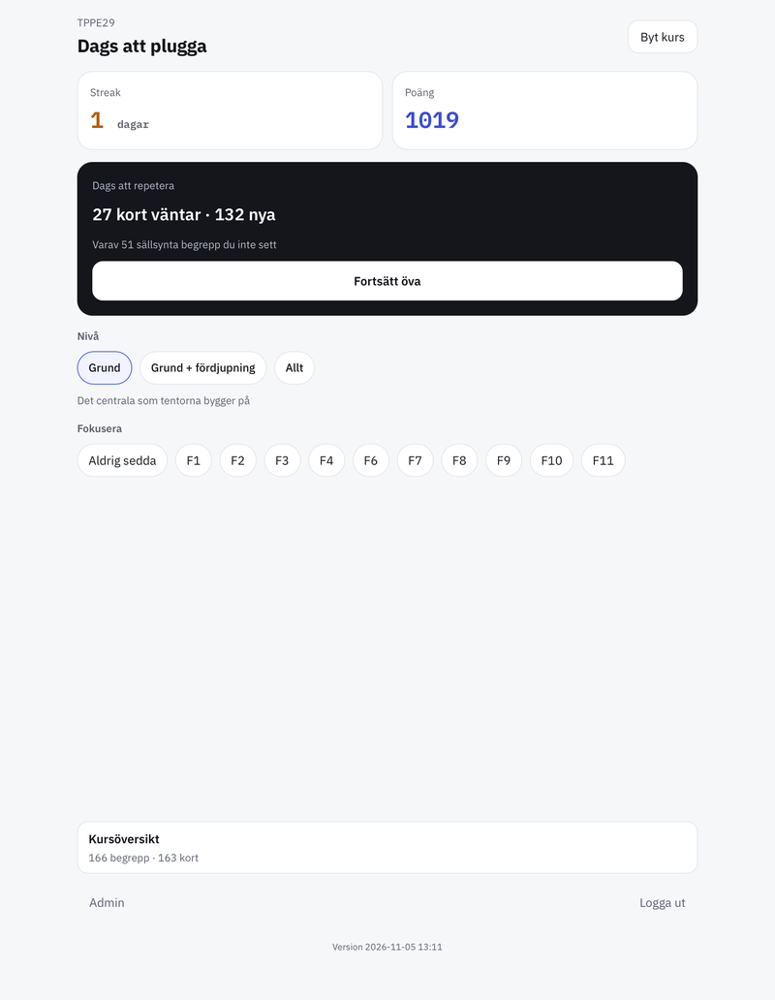
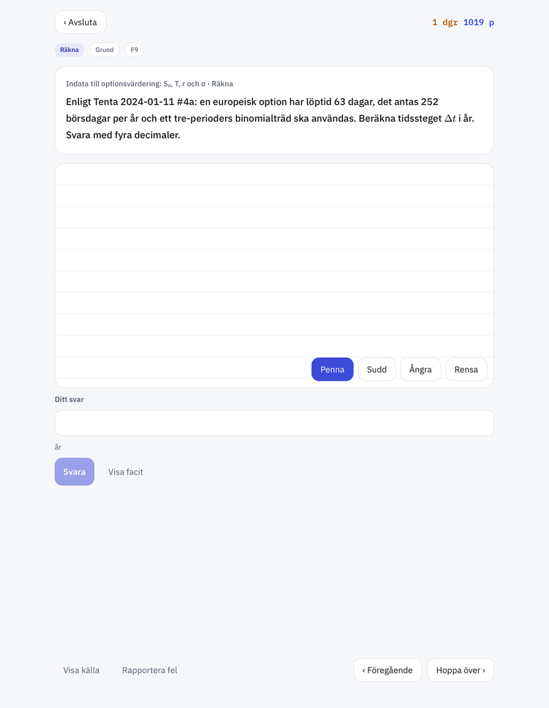
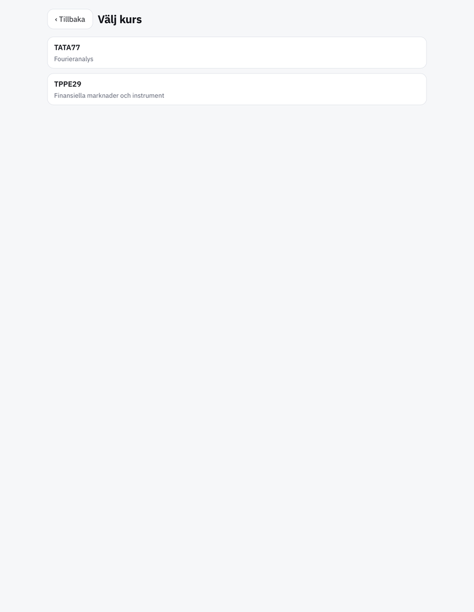

# Teoriträning

PWA för teoriträning inför tentor med spaced repetition. Korten bygger på kursmaterialet och ett AI-stöd rättar svaren, både skrivna och handskrivna. Appen är gjord för iPad med penna.

Live: <https://teoritraning.vercel.app>

<p align="center">
  
  
  
</p>

## Stack

- React 19, TypeScript och Vite (PWA via `vite-plugin-pwa`)
- Supabase för auth (e-post-OTP), databas och en edge function som rättar svar
- `ts-fsrs` för schemaläggning, KaTeX för matematik och `perfect-freehand` för handskrift

## Kom igång

```sh
npm install
cp .env.example .env.local   # fyll i VITE_SUPABASE_URL och VITE_SUPABASE_ANON_KEY
npm run dev
```

| Kommando | Vad det gör |
| --- | --- |
| `npm run dev` | Startar dev-servern |
| `npm test` | Kör testerna (Vitest) |
| `npm run lint` | Kör oxlint |
| `npm run build` | Bygger för produktion |
| `bash scripts/deploy.sh` | Deployar till Vercel |

## Struktur

- `src/`: appen (skärmar, kort, sessioner, SRS och handskrift)
- `supabase/`: migrationer och edge functions
- `bank/`: frågebanker per kurs. De riktiga bankerna bygger på kursmaterial och versionshanteras inte. `bank/example/example.json` är ett påhittat exempel som visar formatet.
- `scripts/`: verktyg för frågebanken (validering, sammanslagning, export till SQL)
- `.claude/skills/kursbank/`: `/kursbank <KURS>` bygger kort från nytt kursmaterial och laddar upp dem till Supabase
